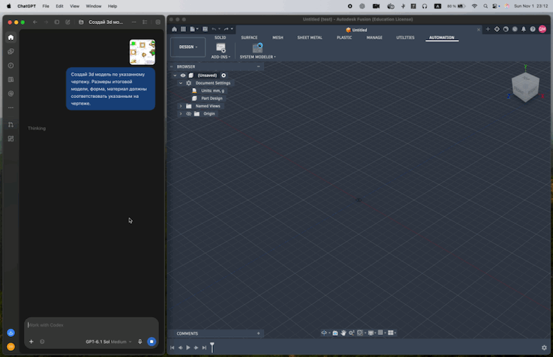

# Fusion360 MCP Server (C#)



*Example of CAD generation with Fusion360 MCP (accelerated playback).*

*An MCP server that connects AI agents (Claude Code, Cursor, and any MCP client) to Autodesk Fusion 360 for CAD automation. The server is C#; the packaged Fusion add-in is Python. This project is inspired by [Kompas3D-MCP](https://github.com/SergeySklyarov/Kompas3D-MCP) and [fusion360-mcp-server](https://github.com/faust-machines/fusion360-mcp-server).*

> **Beta** — under active development. The API and tool behavior may change between releases.

The C# server exposes **92 typed MCP tools**, including `ping` for a connection health check. The upstream Python server also provides `execute_code`; this server and the packaged add-in reject that command. The Python add-in is the only Fusion implementation. macOS live E2E is a release gate; Windows installer CI is required before release and Windows live Fusion E2E follows after release. See the [release task](docs/tasks/python-addin-stable-release.md).

## How it works

```
MCP Client ──stdio──> Fusion360.Mcp.Server (C#, .NET 10) ──TCP :9876──> Fusion360MCP Add-in (Python, inside Fusion) ──CustomEvent──> main thread
```

The project has two components:

1. **MCP server** (`Fusion360.Mcp.Server`, .NET 10) — serves the MCP protocol over stdio, provides a catalog of 92 tools plus resources, templates, and prompts, and forwards commands over TCP.
2. **Fusion360MCP Add-in** (`addon/Fusion360MCP/`, Python) — runs inside Fusion 360 and executes adsk calls on the main thread through a CustomEvent queue. This is the only Fusion add-in implementation in the repository.

## Prerequisites

- Autodesk Fusion 360 on Windows or macOS. Windows installer CI is required before release; live Windows Fusion E2E is scheduled after release.
- [.NET 10 SDK](https://dotnet.microsoft.com/en-us/download/dotnet/10.0) when building or running from source.
- Docker Desktop when using the container image.
- An MCP-compatible client such as Claude Code, OpenCode, Codex, or Cursor.
- A TCP connection from the MCP server host to the Fusion add-in on port `9876`.
- Permission to install the add-in in the Fusion AddIns directory and to update the MCP client configuration.

> Published single-file server binaries (`dist/`) are self-contained and include the .NET runtime.

### Agent-assisted installation

An AI coding agent can perform the installation after you provide access to this repository and the MCP client configuration. If the agent needs to fetch the project, use the canonical repository: [qdimka/fusion360-mcp](https://github.com/qdimka/fusion360-mcp). Give the agent this task:

```text
Clone https://github.com/qdimka/fusion360-mcp if the repository is not already available. Install the Fusion360 MCP server by following docs/INSTALL.md from the repository root.
```

The same instructions are available locally in [`docs/INSTALL.md`](docs/INSTALL.md).

For a local source installation, the agent should use:

```bash
dotnet build Fusion360Mcp.sln -c Release
dotnet src/Fusion360.Mcp.Server/bin/Release/net10.0/Fusion360.Mcp.Server.dll --mode socket
```

For a Docker installation, the MCP client should launch the container directly:

```bash
docker build -t fusion360-mcp:local .
docker run --rm -i -e FUSION_MCP_HOST=host.docker.internal \
  -e FUSION_MCP_PORT=9876 -e FUSION_MCP_JOURNAL_DIR=/data \
  -v fusion360-mcp-journal:/data fusion360-mcp:local --mode socket
```

Install the checked-in Python add-in with the platform script below for a real Fusion connection; `--mode mock` is also available.

## Installation

### 1. Install the Fusion 360 add-in

Choose the installer for the Fusion host platform:

- **macOS:** run `./scripts/install-addon.sh`.
- **Windows:** run `powershell -ExecutionPolicy Bypass -File scripts\install-addon.ps1`.
  Both scripts install the checked-in Python source. Use `--symlink` on macOS
  or `-Symlink` on Windows only for development.

If installing from the release asset instead of a source checkout, extract
`Fusion360MCP-python.zip` outside Fusion's AddIns directory, then run
`sh Fusion360MCP/install-addon.sh` on macOS or
`powershell -ExecutionPolicy Bypass -File Fusion360MCP\install-addon.ps1`
on Windows from the extracted directory. The zip includes both installers.

No upstream clone or C# add-in build is needed for installation. If an older
C# add-in is installed, stop it in Fusion before starting Python to avoid two
listeners on port 9876. Preserve the MCP server's operation journal across
upgrades.

Start Fusion (if it is already open, restart it manually). The Python
manifest has `runOnStartup: false`; start it from **Shift+S → Add-Ins →
Fusion360MCP → Run**.

The TEXT COMMANDS window should show: `[MCP] Server listening on localhost:9876`

### 2. Connect an MCP client

Build or publish the server:

```bash
# quick launch from source (requires the .NET 10 runtime):
dotnet build -c Release
# run:
dotnet src/Fusion360.Mcp.Server/bin/Release/net10.0/Fusion360.Mcp.Server.dll --mode socket

# or self-contained archives plus the Python add-in zip (scripts/publish.sh → dist/):
./scripts/publish.sh
#   dist/Fusion360.Mcp.Server-<rid>.zip and dist/Fusion360MCP-python.zip
```

The server accepts `--mode mock|socket` (`socket` is the default), `--host`, `--port`, and the `FUSION_MCP_HOST` / `FUSION_MCP_PORT` environment variables (see Cross-machine setup below).

#### Claude Code

```bash
claude mcp add fusion360 -- /path/to/Fusion360.Mcp.Server --mode socket
# or from source:
claude mcp add fusion360 -- dotnet /path/to/src/Fusion360.Mcp.Server/bin/Release/net10.0/Fusion360.Mcp.Server.dll --mode socket
```

#### Other MCP clients

The server uses **stdio**, so any MCP client can launch it with this command:

```
/path/to/Fusion360.Mcp.Server --mode socket
```

<details>
<summary><strong>Cursor</strong> (~/.cursor/mcp.json)</summary>

```json
{
  "mcpServers": {
    "fusion360": {
      "command": "/path/to/Fusion360.Mcp.Server",
      "args": ["--mode", "socket"]
    }
  }
}
```
</details>

#### Docker

Build an image from the repository root:

```bash
docker build -t fusion360-mcp:local .
```

GitHub Actions builds and tests the solution on pull requests and pushes to `main`.
A versioned GitHub Release is created only from a pushed `v<version>` tag
matching `Directory.Build.props`, after macOS candidate E2E passes and Windows installer CI succeeds. Windows
live Fusion E2E is deferred until after release. The release attaches server archives, the
Python add-in zip, and checksums. The Docker workflow publishes the main branch
image as `ghcr.io/OWNER/REPOSITORY:main` and `:latest`, and publishes versioned images
for pushed `v*` tags.

The package may require authorization to GHCR if it is not public.

The MCP client must run the container in stdio mode. For example, the command to
client configurations:

```bash
docker run --rm -i -e FUSION_MCP_HOST=host.docker.internal \
  -e FUSION_MCP_PORT=9876 -e FUSION_MCP_JOURNAL_DIR=/data \
  -v fusion360-mcp-journal:/data ghcr.io/OWNER/REPOSITORY:latest --mode socket
```

These options connect to `host.docker.internal:9876` and store the
`operation_id` journal in `/data`. Docker volume `fusion360-mcp-journal`
saves it between runs. For a different add-in address, set the
`FUSION_MCP_HOST` and if necessary `FUSION_MCP_PORT` via `-e`.
The container is started by the MCP client itself: the server communicates via stdin/stdout,
so it should not be run in detached mode.

For local build, replace the image name in the configuration with
`fusion360-mcp:local`: On Linux, pass the host address to the container, for example
`--add-host=host.docker.internal:host-gateway`; then set
`FUSION_MCP_HOST=host.docker.internal` if not allowed
automatically.

### Cross-machine setup (LAN)

If the MCP server and Fusion 360 are running on different machines (e.g. server on Mac Mini, Fusion on Windows), override the binding address with env variables **on both sides**.

**On the Fusion host** (where the add-in runs), before running Fusion, bind to all interfaces:

```bash
export FUSION_MCP_HOST=0.0.0.0     # macOS
$env:FUSION_MCP_HOST = "0.0.0.0"   # Windows
export FUSION_MCP_ALLOW_REMOTE=1   # required opt-in for a non-loopback bind
$env:FUSION_MCP_ALLOW_REMOTE = "1" # Windows
```

The log line `Server listening on 0.0.0.0:9876` confirms bind.

**On the MCP server host** specify the LAN-IP of the Fusion host:

```bash
FUSION_MCP_HOST=192.168.1.42 /path/to/Fusion360.Mcp.Server --mode socket
# or:
/path/to/Fusion360.Mcp.Server --mode socket --host 192.168.1.42
```

**Security note:** TCP socket without authentication. The Python add-in rejects a non-loopback bind unless `FUSION_MCP_ALLOW_REMOTE=1` is set on the Fusion host. Use only in a trusted LAN — never bind to `0.0.0.0` on a host reachable from the public internet.

### 3. Verify the connection

Call `ping` from the client. A successful result contains `status: pong`;
this confirms that the add-in connection is ready.

### Uninstall

1. Remove `fusion360` from MCP client configuration
2. Stop add-in in Fusion (Shift+S → Add-Ins → Fusion360MCP → Stop)
3. Delete the add-in folder from the AddIns directory

## Tools available (92)

The complete, generated tool catalog is maintained in [`docs/TOOLS.md`](docs/TOOLS.md). It includes each tool name, group, description, read-only status, destructive behavior, and idempotency.

> Tools marked **(2026+)** require a current Fusion 360 build with the corresponding API support.

`create_flange` uses Autodesk's [preview edge-flange API](https://help.autodesk.com/cloudhelp/ENU/Fusion-360-API/files/fusion_FlangeFeatures_createEdgeFlangeInput.htm), introduced in October 2026. Autodesk warns that preview APIs may change and should not be used in distributed programs. This project accepts that compatibility risk. A preliminary macOS Fusion 2706.1.17 check created an edge flange on a sheet-metal body; Windows and the complete release matrix remain untested.
